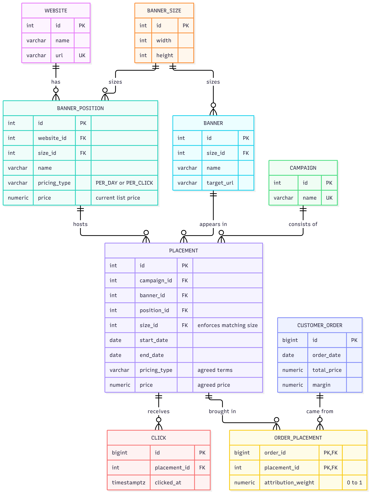

# Banner Campaigns

Uses PostgreSQL.

## a) Data model



## b) Campaign balance

```sql
WITH revenue AS (
    SELECT op.placement_id, SUM(o.margin * op.attribution_weight) AS revenue
    FROM order_placement op
    JOIN customer_order o ON o.id = op.order_id
    GROUP BY op.placement_id
),
clicks AS (
    SELECT placement_id, COUNT(*) AS cnt
    FROM click
    GROUP BY placement_id
),
cost AS (
    SELECT p.id AS placement_id,
           CASE p.pricing_type
               WHEN 'PER_DAY'   THEN p.price * (p.end_date - p.start_date + 1)
               WHEN 'PER_CLICK' THEN p.price * COALESCE(c.cnt, 0)
           END AS cost
    FROM placement p
    LEFT JOIN clicks c ON c.placement_id = p.id
)
SELECT ca.id, ca.name,
       COALESCE(SUM(r.revenue), 0) - COALESCE(SUM(co.cost), 0) AS balance
FROM campaign ca
LEFT JOIN placement p ON p.campaign_id = ca.id
LEFT JOIN revenue r   ON r.placement_id = p.id
LEFT JOIN cost co     ON co.placement_id = p.id
GROUP BY ca.id, ca.name
ORDER BY balance DESC;
```

## c) PER_DAY balance by weekday

```sql
WITH days AS (
    SELECT * FROM (VALUES
        (1,'Monday'),(2,'Tuesday'),(3,'Wednesday'),(4,'Thursday'),
        (5,'Friday'),(6,'Saturday'),(7,'Sunday')) AS g(dow, label)
),
cost AS (
    SELECT EXTRACT(ISODOW FROM d)::int AS dow, SUM(p.price) AS cost
    FROM placement p
    CROSS JOIN LATERAL generate_series(p.start_date, p.end_date, interval '1 day') d
    WHERE p.pricing_type = 'PER_DAY'
    GROUP BY 1
),
revenue AS (
    SELECT EXTRACT(ISODOW FROM o.order_date)::int AS dow,
           SUM(o.margin * op.attribution_weight) AS revenue
    FROM order_placement op
    JOIN placement p      ON p.id = op.placement_id
    JOIN customer_order o ON o.id = op.order_id
    WHERE p.pricing_type = 'PER_DAY'
    GROUP BY 1
)
SELECT d.label,
       COALESCE(r.revenue, 0) - COALESCE(c.cost, 0) AS balance
FROM days d
LEFT JOIN cost c    ON c.dow = d.dow
LEFT JOIN revenue r ON r.dow = d.dow
ORDER BY d.dow;
```

## d) Indexes

```sql
CREATE INDEX ix_click_placement           ON click (placement_id, clicked_at);
CREATE INDEX ix_order_placement_placement ON order_placement (placement_id) INCLUDE (attribution_weight);
CREATE INDEX ix_placement_campaign        ON placement (campaign_id);
CREATE INDEX ix_order_date                ON customer_order (order_date);
```

## e) Constraints

```sql
-- banner and position must have the same size
ALTER TABLE banner          ADD UNIQUE (id, size_id);
ALTER TABLE banner_position ADD UNIQUE (id, size_id);
ALTER TABLE placement ADD FOREIGN KEY (banner_id, size_id)   REFERENCES banner (id, size_id);
ALTER TABLE placement ADD FOREIGN KEY (position_id, size_id) REFERENCES banner_position (id, size_id);

-- one position cannot host two placements at the same time
CREATE EXTENSION btree_gist;
ALTER TABLE placement ADD EXCLUDE USING gist
    (position_id WITH =, daterange(start_date, end_date, '[]') WITH &&);
```

- PK / FK / NOT NULL as in the diagram
- UNIQUE: `website.url`, `campaign.name`, `banner_size (width, height)`
- CHECK: `pricing_type IN ('PER_DAY','PER_CLICK')`, `price >= 0`, `width, height > 0`, `end_date >= start_date`, `attribution_weight BETWEEN 0 AND 1`
- Trigger: the attribution weights of one order add up to at most 1
